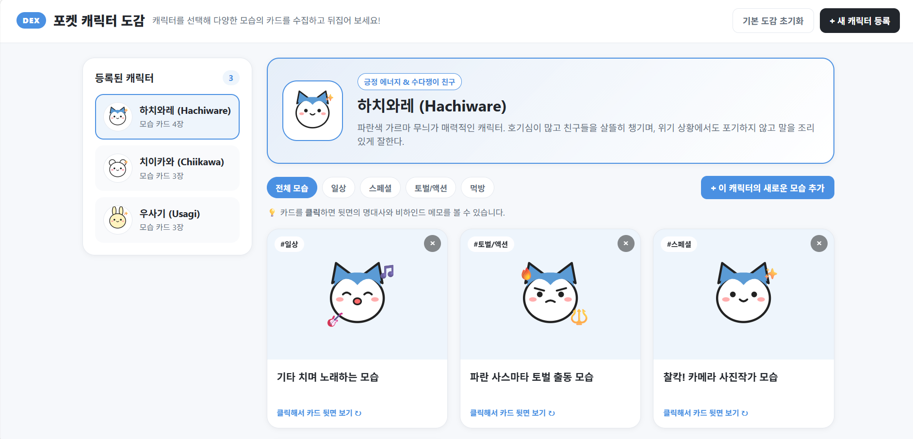
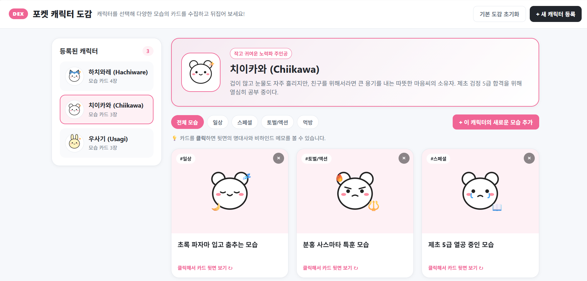
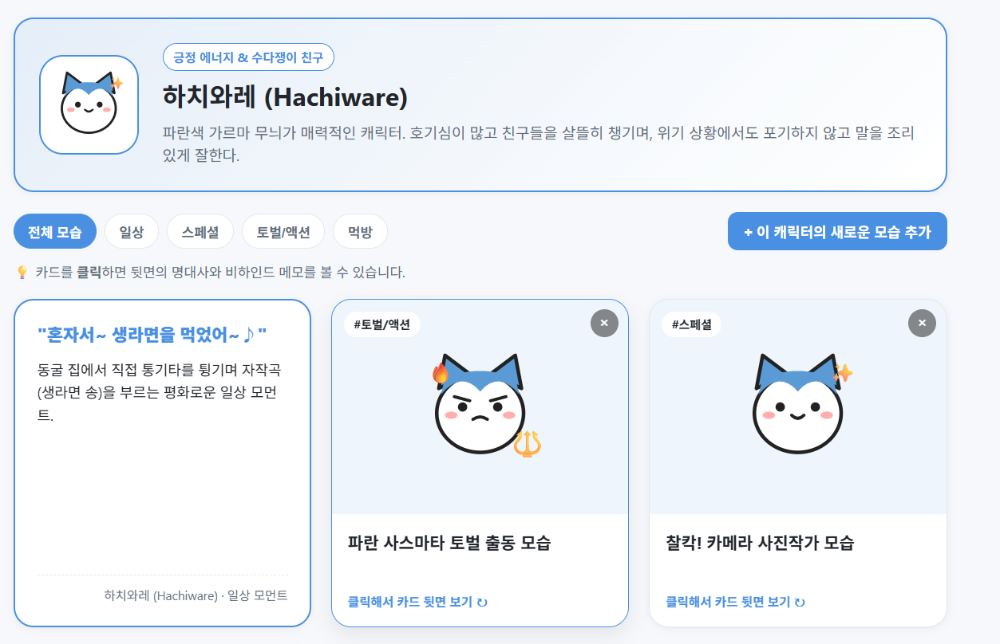
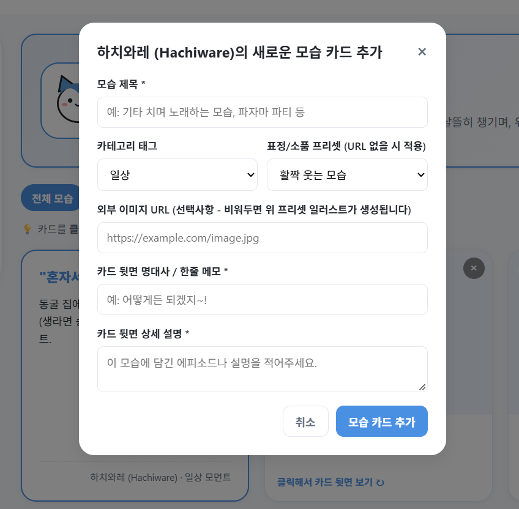

# 🐾 포켓 캐릭터 도감 & 멀티 카드 뷰어 (Pocket Character Dex)

> **배포 URL (GitHub Pages):** [https://use01098616226-jwa.github.io/character-dex/](https://use01098616226-jwa.github.io/character-dex/)  
> **실행 환경:** Chrome, Edge, Safari 등 모든 모던 웹 브라우저 (외부 패키지 설치 및 빌드 과정 없이 즉시 실행 가능)  
> **기술 스택:** HTML5, CSS3 (CSS Variables, 3D Transform, Grid/Flexbox), Vanilla JavaScript (ES6+), Web Storage API (`localStorage`)

---

## 📂 프로젝트 문서 바로가기
본 저장소는 바이브 코딩(Vibe Coding) 워크플로우와 평가 기준에 맞춰 각 설계 및 검증 문서를 체계적으로 분리하여 관리하고 있습니다.
- 📋 **[PRD.md (제품 요구사항 정의서 전문)](./PRD.md)**
- ✅ **[TODO.md (초기 Todo 리스트 및 변경 히스토리)](./TODO.md)**
- 🛠️ **[SKILL.md (바이브 코딩 커스텀 스킬 정의서)](./SKILL.md)**
- 🧪 **[docs/TEST_SCENARIOS.md (브라우저 자체 테스트 시나리오 및 결과)](./docs/TEST_SCENARIOS.md)**

---

## 📌 프로젝트 한눈에 보기 (평가자용 1분 실행 가이드)

처음 접속하시는 분들도 별도의 설명 없이 아래 **4가지 동작**을 순서대로 클릭해 보시면 웹앱의 모든 핵심 기능을 즉시 확인하실 수 있습니다.


*▲ 포켓 캐릭터 도감 메인 실행 화면 (좌측 1:N 캐릭터 선택 사이드바 및 우측 멀티 포토카드 그리드)*

1. **캐릭터 전환 및 다이내믹 테마 확인 (좌측 사이드바)**
   - 좌측 목록에서 `하치와레`, `치이카와`, `우사기`를 번갈아 클릭해 보세요.
   - 선택한 캐릭터의 고유 테마 컬러(파랑 `#4A90E2` / 분홍 `#FF7EB3` / 노랑 `#F5A623`)에 맞춰 상단 배너, 태그 버튼, 강조 테두리 색상이 실시간으로 전환되며 해당 캐릭터의 카드 목록이 렌더링됩니다.
2. **3D 포토카드 뒤집기 (우측 카드 그리드)**
   - 진열된 모습 카드를 **클릭**해 보세요. 카드가 Y축을 기준으로 180도 입체 회전하며, 카드 뒷면에 숨겨진 캐릭터의 에피소드 명대사와 비하인드 설명을 감상할 수 있습니다.
3. **태그 필터링 & 실시간 키워드 검색 (상단 컨트롤 바)**
   - `#일상`, `#스페셜`, `#토벌/액션`, `#먹방` 카테고리 버튼을 누르거나 우측 검색창에 `라면`, `기타`, `사스마타` 같은 단어를 입력해 보세요. 제목, 대사, 설명에 해당 키워드가 포함된 카드만 즉시 필터링됩니다.
4. **새 캐릭터/카드 등록 및 데이터 영속성 확인 (우측 상단 버튼)**
   - `+ 새 캐릭터 등록` 또는 배너 우측의 `+ 이 캐릭터의 새로운 모습 추가` 버튼을 눌러 나만의 카드를 추가한 뒤 브라우저를 **새로고침(F5)** 해보세요. `localStorage`를 통해 데이터가 그대로 보존되며, 상단 `기본 도감 초기화` 버튼을 누르면 언제든 초기 샘플 상태로 복구됩니다.

---

## 1. 제작한 것 소개 및 시스템 아키텍처

### 1.1 기획 배경 및 제작 의도
기존의 일반적인 캐릭터 소개 웹페이지들은 캐릭터 1명당 고정된 프로필 사진 1장과 정적인 텍스트만 나열하는 한계가 있었습니다. 하지만 애니메이션이나 만화 캐릭터의 진짜 매력은 **일상적인 모습, 무기(사스마타, 토벌봉)를 들고 진지하게 토벌에 나서는 모습, 맛있게 음식을 먹는 모습 등 에피소드마다 달라지는 다채로운 모먼트(Moment)**에 있습니다.

이에 착안하여 **"내가 좋아하는 캐릭터들을 도감에 등록하고, 한 캐릭터가 가진 여러 가지 에피소드별 모습을 양면 포토카드 형태로 수집·분류하고 뒤집어 볼 수 있는 1:N 인터랙티브 웹 도감"**을 기획하고 바이브 코딩으로 구현했습니다.

### 1.2 화면 구성 및 주요 기능 상세

#### ① 캐릭터별 다이내믹 테마 시스템 (Dynamic Theme Engine)
캐릭터마다 고유한 개성을 시각적으로 표현하기 위해 CSS 커스텀 프로퍼티(`--theme-accent`, `--theme-bg-soft`)를 활용했습니다. 사용자가 좌측 사이드바에서 다른 캐릭터를 선택하면 `applyThemeColor()` 함수가 HEX 색상 코드를 RGB로 분해하여 배경 그라데이션과 버튼 색상을 즉각 재계산합니다.


*▲ 캐릭터 선택에 따라 상단 프로필 배너와 UI 전체의 포인트 컬러가 동적으로 전환되는 모습*

#### ② 3D 플립(Flip) 양면 포토카드 & 실시간 복합 필터링
- **카드 앞면 (Front):** 상황별 캐릭터 일러스트, 카테고리 뱃지(`#일상`, `#먹방` 등), 모습 제목, 카드 개별 삭제(`✕`) 버튼으로 구성됩니다.
- **카드 뒷면 (Back):** 에피소드 대표 명대사(인용구 스타일), 상세 비하인드 스토리, 소속 캐릭터 정보가 표시됩니다.
- **복합 필터링:** 현재 선택된 태그(`activeTag`)와 검색어(`searchQuery`)의 교집합을 계산하여 일치하는 카드만 화면에 그리며, 조건에 맞는 카드가 없을 경우 안내 문구(Empty State)를 출력합니다.


*▲ 카드를 클릭해 180도 뒤집은 뒷면 모습(좌)과 키워드 검색 및 태그 필터를 적용한 모습(우)*

#### ③ 내장 SVG 일러스트 생성 엔진 (Zero-Broken-Image Architecture)
사용자가 카드를 추가할 때 이미지 URL을 구하지 못하거나 잘못된 주소를 입력하더라도 도감의 시각적 완성도가 깨지지 않도록, 순수 JavaScript로 동작하는 **벡터 일러스트 조합 엔진(`generateCharacterSVG`)**을 직접 구현했습니다.
- **외형 프리셋 4종:** 고양이형(`cat`), 곰돌이형(`bear`), 토끼형(`rabbit`), 다람쥐형(`squirrel`)의 귀 모양과 얼굴 윤곽선 자동 생성
- **감정/상황 프리셋 6종:** 기본 미소(`happy`), 기타 연주와 음표(`sing`), 토벌 무기와 결연한 눈빛(`battle`), 당고 먹방과 반짝이는 눈(`eat`), 파자마와 수면 방울(`sleep`), 감동의 눈물(`cry`) 소품 및 표정 레이어 합성


*▲ 새로운 캐릭터 등록 모달 및 캐릭터별 새로운 모습 카드 추가 모달 인터페이스*

### 1.3 데이터 흐름 및 아키텍처 구조
외부 라이브러리 없이 단일 페이지 애플리케이션(SPA)의 상태 관리를 구현하기 위해 아래와 같은 단방향 데이터 흐름(State -> Storage -> Render)으로 설계했습니다.

```text
[사용자 액션 (클릭 / 검색 / 모달 폼 제출)]
       │
       ▼
[Event Listeners & Event Delegation (app.js)]
       │
       ├── (데이터 변경 시) ──▶ [State 업데이트 (characters 배열)] ──▶ [localStorage 동기화 (saveToStorage)]
       │                                                                   │
       ▼                                                                   ▼
[UI 재렌더링 파이프라인] ◀─────────────────────────────────────────────────┘
  ├─ renderCharacterList() : 좌측 사이드바 목록 및 보유 카드 수 배지 갱신
  ├─ applyThemeColor()     : 선택된 캐릭터의 테마 컬러를 CSS 변수에 주입
  ├─ renderProfileBanner() : 상단 캐릭터 아바타(SVG) 및 소개글 배너 갱신
  └─ renderCardGrid()      : 태그/검색어 필터링 후 3D 플립 카드 DOM 생성 (XSS 방지 이스케이프 적용)
```

---

## 2. PRD (제품 요구사항 정의서) 및 초기 Todo 리스트

> 📄 상세 스키마 정의 및 전체 요구사항은 **[PRD.md](./PRD.md)** 파일에서도 확인하실 수 있습니다.

### 2.1 PRD 요약

| 구분 | 요구사항 상세 내용 |
| :--- | :--- |
| **제품명** | 포켓 캐릭터 도감 & 멀티 카드 뷰어 (Pocket Character Dex) |
| **핵심 목표** | 서버나 DB, 빌드 도구 없이 웹 브라우저만으로 동작하며, 캐릭터(1) 등록과 캐릭터별 다중 모습 카드(N) 수집·감상이 가능한 인터랙티브 SPA 구현 |
| **핵심 유저 스토리** | 1. 사용자는 새로운 캐릭터(이름, 별명, 소개, 테마 색상, 외형 타입)를 도감에 등록하고 삭제할 수 있다.<br>2. 사용자는 특정 캐릭터를 선택해 그 캐릭터의 다양한 모습 카드를 한눈에 모아볼 수 있다.<br>3. 사용자는 각 캐릭터에 새로운 모습 카드(제목, 분류 태그, 상황 프리셋 또는 외부 이미지 URL, 뒷면 명대사 및 설명)를 추가할 수 있다.<br>4. 사용자는 태그 버튼과 실시간 검색창을 통해 원하는 모습 카드만 빠르게 찾아볼 수 있다. |
| **비기능적 요구사항** | - **즉시 실행 가능성:** Zero-Dependency 원칙을 준수하여 로컬 `index.html` 실행 및 GitHub Pages 환경에서 에러 없이 즉시 작동해야 함<br>- **데이터 영속성:** `localStorage`를 활용하여 새로고침 및 브라우저 재실행 시에도 사용자 데이터 보존<br>- **예외 처리:** 이미지 로드 실패(`onerror`), 빈 입력값, XSS 스크립트 삽입, 전체 캐릭터 삭제 시도 등에 대한 방어 로직 적용 |
| **파일 구조** | - `index.html` : 시맨틱 레이아웃 및 2종의 등록 모달 마크업<br>- `style.css` : 반응형 2단 그리드, 모달, 3D 카드 플립 애니메이션 스타일<br>- `app.js` : 상태 관리, 동적 SVG 생성 엔진, 필터링, 로컬 스토리지 연동<br>- `SKILL.md` / `PRD.md` / `TODO.md` / `docs/TEST_SCENARIOS.md` : 설계 및 검증 문서 |

### 2.2 초기 Todo 리스트 (개발 착수 시점 계획)
프로젝트 시작 단계에서 기능 단위로 분할하여 수립했던 초기 Todo 리스트입니다.

- [x] **Step 1:** 프로젝트 기획 문서(`PRD.md`, 초기 `TODO.md`) 및 바이브 코딩 규칙(`SKILL.md`) 수립
- [x] **Step 2:** 좌측 캐릭터 사이드바 + 우측 카드 갤러리 2단 반응형 레이아웃(`index.html`, `style.css`) 구현
- [x] **Step 3:** 초기 샘플 캐릭터 3종(하치와레, 치이카와, 우사기) 및 에피소드별 모습 카드 10종 기본 데이터 구축
- [x] **Step 4:** 캐릭터 선택 시 상단 프로필 배너 및 하단 모습 카드 그리드 동적 렌더링 구현
- [x] **Step 5:** 신규 캐릭터 등록 모달 및 선택한 캐릭터의 '새로운 모습 카드 추가' 모달 구현
- [ ] **Step 6 (초기 계획 → 테스트 후 수정됨):** `<input type="file">`을 이용해 로컬 PC 이미지 파일을 업로드하고 Base64 문자열로 변환해 저장하는 기능
- [ ] **Step 7 (초기 계획 → 테스트 후 수정됨):** 마우스 커서를 카드 위에 올리면(`:hover`) 카드가 자동으로 뒤집히는 3D 효과
- [ ] **Step 8 (초기 계획 → 테스트 후 제외됨):** 마우스 드래그 앤 드롭으로 카드 진열 순서를 바꾸는 기능
- [x] **Step 9:** `localStorage` 연동으로 등록·삭제 데이터 자동 저장 및 유지 기능 구현

---

## 3. Todo 리스트의 변경 내역 (브라우저 테스트 기반 개선 과정)

> 📄 버전별 상세 변경 로그와 테스트 체크리스트는 **[TODO.md](./TODO.md)** 및 **[docs/TEST_SCENARIOS.md](./docs/TEST_SCENARIOS.md)**에서 확인하실 수 있습니다.

바이브 코딩으로 1차 프로토타입을 구현한 뒤, 실제 브라우저에서 기능을 하나씩 조작하며 테스트하는 과정에서 발견된 기술적 한계와 UX 문제를 해결하기 위해 초기 Todo 리스트를 다음과 같이 수정·제외·추가했습니다.

### 3.1 기능 수정 내역 (Modified)

#### 🔧 [수정 1] 이미지 등록 방식: 로컬 파일(Base64) 업로드 ➔ `내장 SVG 상황별 프리셋 + 외부 이미지 URL 하이브리드 방식`으로 변경
- **초기 계획:** 사용자가 PC에 있는 이미지 파일을 직접 선택해 업로드하면 `FileReader`로 Base64 인코딩하여 `localStorage`에 저장하려 했습니다.
- **테스트 중 발견한 문제:** 고해상도 캐릭터 이미지 3~4장만 Base64 문자열로 변환해도 브라우저 `localStorage`의 최대 허용 용량(약 5MB)을 즉시 초과하여 `QuotaExceededError` 예외가 발생하며 이후 모든 저장 기능이 먹통이 되는 치명적인 문제를 발견했습니다.
- **해결 및 반영 결과:** 스토리지 용량 부담이 전혀 없도록 ① 외부 이미지 URL을 텍스트로 입력받거나, ② 이미지 URL을 비워두더라도 사용자가 선택한 외형과 상황/표정 프리셋(노래, 토벌, 먹방 등 6종)을 조합해 즉석에서 고화질 벡터 그래픽을 그려내는 `generateCharacterSVG()` 엔진으로 설계를 변경했습니다. 또한 외부 URL 이미지가 만료되어 로드에 실패(`onerror`)하더라도 깨진 아이콘 대신 내장 SVG 일러스트로 자동 전환(Fallback)되도록 안전성을 높였습니다.

#### 🔧 [수정 2] 3D 카드 뒤집기 인터랙션: 마우스 호버(`:hover`) ➔ `마우스 클릭 토글(Click Toggle)` 방식으로 변경
- **초기 계획:** CSS `.flip-card:hover .flip-card-inner` 선택자만으로 마우스 커서가 카드에 닿으면 즉시 뒤집히도록 구현했습니다.
- **테스트 중 발견한 문제:** 화면에서 마우스를 이동할 때마다 스쳐 지나가는 카드들이 의도치 않게 연달아 회전하여 시각적 피로도가 심했고, 결정적으로 카드 앞면 우측 상단에 있는 **삭제(`✕`) 버튼을 누르려고 마우스를 가져가면 카드가 뒷면으로 뒤집혀버려 삭제 버튼을 클릭할 수 없는 버그**가 발생했습니다. 또한 모바일·태블릿 터치 화면에서는 `:hover`가 정상 작동하지 않았습니다.
- **해결 및 반영 결과:** CSS에서 `:hover` 회전 규칙을 제거하고, JavaScript 클릭 이벤트 위임을 통해 카드를 명시적으로 클릭했을 때만 `.is-flipped` 클래스가 토글되도록 수정했습니다. 아울러 삭제 버튼 클릭 시에는 `e.stopPropagation()`을 호출해 카드가 뒤집히지 않고 안전하게 삭제 확인창만 뜨도록 이벤트를 분리했습니다.

### 3.2 기능 제외 내역 (Removed)

#### ❌ [제외] 드래그 앤 드롭 카드 순서 변경 기능 제외 ➔ `태그 필터 + 실시간 키워드 검색`에 집중
- **제외 사유:** 브라우저 테스트 결과 카드를 클릭해 뒤집는 동작과 드래그 시작 이벤트가 빈번하게 충돌하여 조작감이 떨어졌습니다. 또한 수집된 카드가 많아질수록 수동으로 순서를 바꾸는 것보다 원하는 에피소드나 대사를 즉시 찾아주는 검색 및 태그 필터 기능이 사용자에게 훨씬 유용하다고 판단하여 과감히 제외했습니다.

### 3.3 테스트 후 새로 추가한 항목 (Added)

- **➕ [추가 1] 실시간 모습 카드 키워드 검색창 (`#searchInput`) 추가:** 태그 필터만으로는 특정 에피소드(예: `생라면`, `파자마`, `야하`)를 바로 찾기 아쉬워, 카드 제목·명대사·설명을 실시간으로 대조해 카드를 걸러주는 검색창을 컨트롤 바에 추가했습니다.
- **➕ [추가 2] 캐릭터별 동적 테마 컬러 시스템 (`applyThemeColor`) 추가:** 캐릭터를 전환할 때 현재 누구의 도감을 보고 있는지 직관적으로 체감할 수 있도록, 캐릭터마다 고유 테마 색상을 부여하고 선택 시 화면 전체 테마가 바뀌도록 개선했습니다.
- **➕ [추가 3] 개별 삭제 예외 처리 및 '기본 도감 초기화' 버튼 추가:** 테스트 중 넣은 더미 데이터를 손쉽게 정리하거나 초기 샘플 상태로 단번에 되돌릴 수 있도록 초기화 버튼을 상단에 배치했습니다. 이때 사용자가 모든 캐릭터를 지워 화면이 완전히 비어버리는 상황을 막기 위해 마지막 1명의 캐릭터는 삭제할 수 없도록 방어 로직을 추가했습니다.

---

## 4. 사용한 스킬 (Skill)

### 4.1 스킬 직접 제작 및 선택 이유
이번 프로젝트에서는 바이브 코딩의 일관성과 브라우저 실행 안정성을 확보하기 위해 프로젝트 전용 커스텀 스킬인 **`character-dex-builder`를 직접 제작([`SKILL.md`](./SKILL.md))하여 적용**했습니다. 직접 스킬을 정의한 핵심 이유는 다음과 같습니다.

1. **Zero-Build 실행 환경 제약 강제:** 일반 프롬프트만 사용할 경우 AI가 습관적으로 React, Tailwind CDN, 혹은 외부 아이콘 패키지를 불러오려 시도하여 로컬 실행이나 정적 배포 시 오류를 유발하는 경우가 많습니다. 이를 원천 차단하고 순수 HTML/CSS/Vanilla JS와 상대 경로만 사용하도록 고정 규칙을 부여했습니다.
2. **1:N 데이터 스키마 및 SVG Fallback 일관성 유지:** 기능을 단계별로 추가하고 리팩토링하는 과정에서 `Character(1) - Variant(N)` 데이터 구조가 흔들리지 않게 잡아주고, 모든 이미지 렌더링 지점에 내장 SVG Fallback이 일관되게 적용되도록 강제했습니다.

### 4.2 `SKILL.md` 정의 내용
프로젝트 루트의 [`SKILL.md`](./SKILL.md)에 정의된 규칙 전문입니다.

```yaml
---
name: character-dex-builder
description: 외부 프레임워크나 빌드 도구 없이 브라우저에서 즉시 실행 가능한 순수 HTML5/CSS3/Vanilla JS 기반의 '미니 캐릭터 도감 및 멀티 카드 뷰어'를 설계하고 단계별로 구현하는 스킬입니다.
---
```

- **규칙 1 (Zero-Build 브라우저 실행 보장):** 순수 HTML5, CSS3, Vanilla JS만 사용하며, 로컬 및 GitHub Pages 환경 모두에서 경로 에러(404)가 없도록 상대 경로(`./style.css`, `./app.js`)로 연결한다.
- **규칙 2 (1:N 계층형 데이터 스키마 유지):** 단일 캐릭터(`Character`) 객체 내부에 다양한 모습 카드를 담는 `variants` 배열을 포함시켜 1:N 구조를 유지한다.
- **규칙 3 (시각적 무결성 및 이미지 Fallback 시스템):** 외부 이미지 URL 미입력 또는 로드 실패(`onerror`) 시 빈 박스가 노출되지 않도록 내장 SVG 생성기(`generateCharacterSVG`)를 기본 렌더링 엔진으로 사용한다.
- **규칙 4 (3D 카드 플립 인터랙션 표준):** `perspective: 1000px`, `preserve-3d`, `backface-visibility: hidden`을 사용하며, `:hover`가 아닌 JS 클릭 이벤트(`.is-flipped` 토글)로 제어를 통일한다.
- **규칙 5 (안전한 DOM 처리 및 상태 영속성):** 사용자 입력값은 `escapeHTML` 처리를 거쳐 렌더링하며, 모든 상태 변경 직후 `localStorage`에 즉시 동기화한다.
- **규칙 6 (단계별 구현 및 커밋 연동):** 기획 문서화 ➔ UI 레이아웃 ➔ 코어 렌더링 ➔ 테스트 및 리팩토링 단계별로 코드를 작성하여 Git 커밋 내역에 개발 과정이 드러나도록 한다.

---

## 5. 느낀점 및 결론

이번 중간고사 과제를 수행하며 바이브 코딩은 단순히 AI에게 막연한 결과물을 위임하는 작업이 아니라, 개발자가 명확한 아키텍처와 제약 조건을 설계하고 지속적인 검증을 통해 결과물을 통제해 나가는 고도의 엔지니어링 협업 과정임을 체감했다. 특히 프롬프트에만 의존할 경우 발생할 수 있는 코드의 파편화나 불필요한 외부 라이브러리 의존성 문제를 사전에 차단하기 위해, `SKILL.md`에 'Zero-Build 실행 환경 보장'과 '1:N 계층형 데이터 스키마(`Character` - `Variant`) 유지'라는 구체적인 가드레일을 설정한 것이 프로젝트 전반의 일관성을 유지하는 데 결정적인 역할을 했다.

가장 인상 깊었던 경험은 초기 기획 단계의 이상적인 설계와 실제 브라우저 런타임 환경 사이의 간극을 발견하고 이를 기술적으로 돌파해 나간 과정이었다. 최초 Todo 리스트를 수립할 당시에는 사용자 편의성을 위해 로컬 이미지를 Base64 문자열로 인코딩하여 저장하거나 CSS `:hover` 의사 클래스만으로 3D 카드를 뒤집는 방식을 구상했다. 그러나 실제 브라우저에서 구동하고 반복 테스트를 거치면서 두 가지 구체적인 한계에 직면했다.
첫째, 고해상도 이미지 몇 장만 Base64로 변환해도 브라우저 `localStorage`의 5MB 용량 제한을 초과하여 에러가 발생하였다. 이를 해결하기 위해 기존 파일 업로드 방식을 캐릭터의 외형 타입과 감정/소품 프리셋을 조합해 런타임에 벡터 그래픽을 즉석에서 그려내는 내장 SVG 생성 엔진과 외부 URL 폴백 하이브리드 아키텍처로 바꾸었다. 이 결정은 스토리지 용량 문제를 근본적으로 해결했을 뿐만 아니라, 이미지 링크가 깨지더라도 도감의 시각적 무결성을 100% 보장하는 결과로 이어졌다.
둘째, 마우스 호버 기반의 카드 플립은 커서 이동 경로에 있는 카드들이 의도치 않게 연속 회전하며 시각적 피로도를 유발했고, 결정적으로 카드 우측 상단의 삭제(`✕`) 버튼을 클릭하려 할 때 카드가 뒤집혀버려 버튼 조작이 불가능해지는 UX 결함을 드러냈다. 이를 해결하기 위해 인터랙션 방식을 JavaScript 클릭 토글(`.is-flipped`)로 전면 수정하고, 삭제 버튼 클릭 이벤트에 `e.stopPropagation()`을 적용해 부모 요소로의 이벤트 버블링을 차단함으로써 카드 회전과 삭제 동작을 명확히 분리해 냈다.

또한 초기 계획에는 없었지만 직접 사용자의 입장에서 도감을 조작해 보며 발견한 니즈를 바탕으로, CSS 커스텀 프로퍼티(`--theme-accent`)를 실시간으로 갱신하는 캐릭터별 다이내믹 테마 시스템과 태그·키워드 교집합 필터링, 그리고 사용자 입력값에 대한 XSS 방지 이스케이프(`escapeHTML`) 처리 및 최소 1명의 캐릭터를 유지하는 삭제 방어 로직 등을 추가하며 애플리케이션의 완성도를 끌어올렸다.

결과적으로 `PRD.md`와 `SKILL.md`를 통해 설계 기준을 확립하고, `TODO.md` 단위로 작업을 세분화하여 단계별 Git 커밋으로 이력을 관리하며, 브라우저 테스트(`TEST_SCENARIOS.md`)를 근거로 초기 계획을 유연하게 수정해 나간 이번 경험은 문서 기반 개발과 점진적 리팩토링의 중요성을 깊이 이해하는 계기가 되었다. 이러한 체계적인 워크플로우는 향후 더 복잡한 상태 관리와 대규모 아키텍처가 요구되는 웹 프로젝트를 수행할 때 탄탄한 밑거름이 될 것이다.

